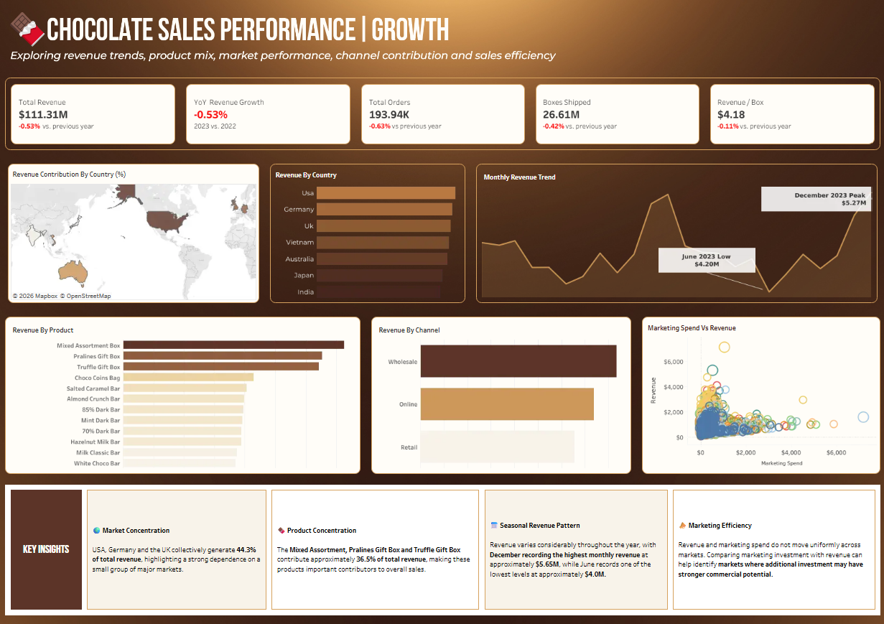
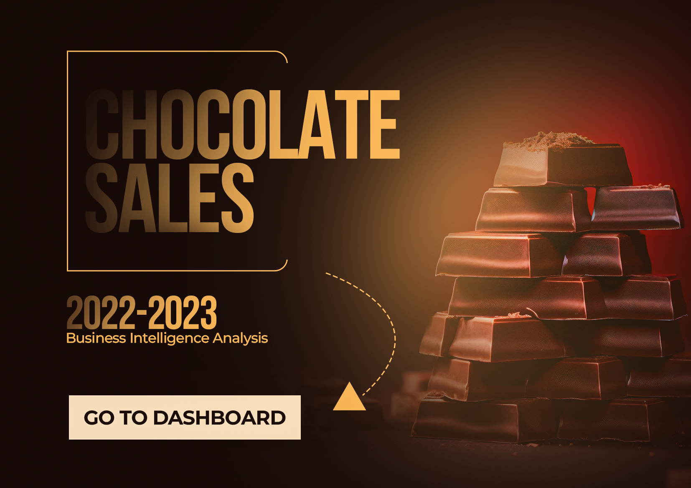
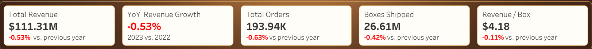
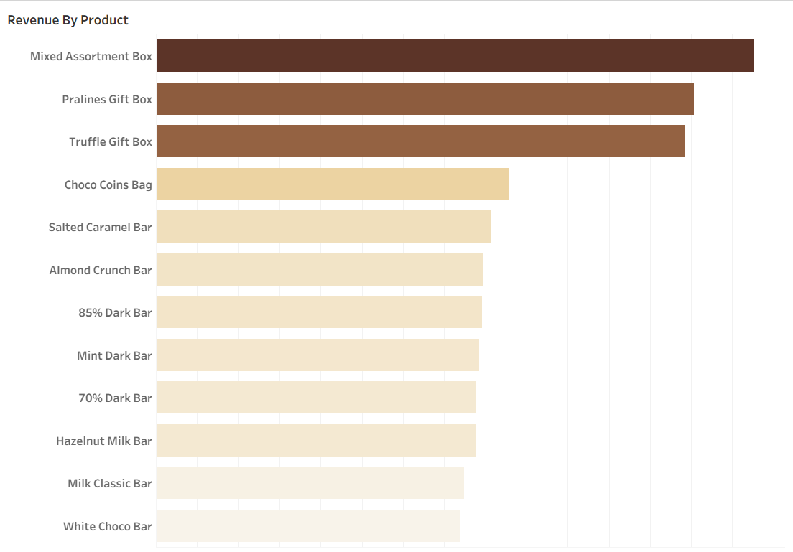
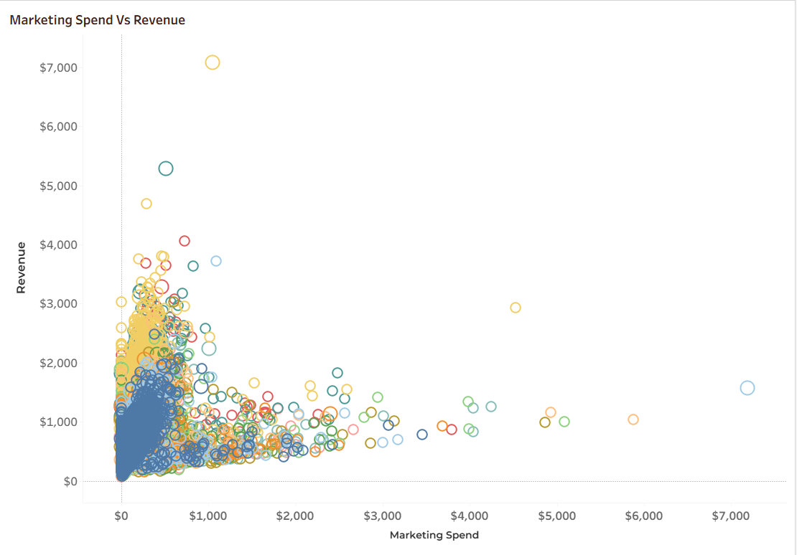
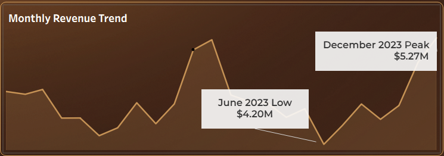

# 🍫 Chocolate Sales Executive Dashboard
### Seasonality, marketing effectiveness, and the year-over-year drop: built in Python + Tableau



**🔗 [View the live dashboard on Tableau Public]([https://public.tableau.com/app/profile/oghenefejiro.ugbama/viz/Chocolate_Sales_17908039272310/CoverPage])**

**🐍 [View the Python data cleaning project]([https://github.com/Oghenefejiro-Godwin/Chocolate-Sales-Analysis])**

---

## Overview

This dashboard was built for **top level management** and it providesanswers to three questions executives care about:

1. **How are sales performing?** The overall level of sales across the business.
2. **What has been happening lately?** Trends, growth, and year-over-year movement.
3. **Why are things the way they are?** The drivers behind the numbers, with written insights alongside the data.

The project covers the full analytics workflow: cleaning raw data in Python, building strategic views in Tableau, designing a branded cover page in Photoshop, and writing up the findings for decision-makers.

## Tools

| Stage | Tool |
|---|---|
| Data cleaning | Python (pandas) |
| Visualisation & calculated fields | Tableau |
| Cover page design | Adobe Photoshop |
| Data | `Chocolate_Sales_Cleaned.csv` |

---

## 1. Cleaning the Dataset

A dashboard is only as trustworthy as the data under it, so I cleaned the dataset in Python before building anything. The full notebook is here: **[Python cleaning project]([https://github.com/Oghenefejiro-Godwin/Chocolate-Sales-Analysis])**.

### What I found and how I fixed it

| Column(s) | Problem | Fix |
|---|---|---|
| All headers | Mixed capitalisation | Converted to lowercase |
| `product`, `country`, `channel` | Extra whitespace, inconsistent capitalisation, placeholder values (`______`, `?`, `#Ref!`, `Unknown`) and blanks | Stripped whitespace, standardised to title case, dropped rows with unusable values |
| `boxes_shipped` | Contained `-` characters | Removed them and converted to a numeric type |
| `amount` | Stored as text with `$` and `,` | Stripped the symbols and converted to float |
| `discount_pct`, `marketing_spend` | Missing values | Filled with `0` |
| `price_per_box` | Missing values | Calculated as `amount / boxes_shipped`, rounded to 2 d.p. |
| `order_date` | Inconsistent separators and formats | Standardised separators and parsed to a proper datetime (day-first) |
| All | Remaining blank rows | Dropped |

### A few key steps

```python
# Standardise text columns, then remove placeholder values
df["country"] = df["country"].str.strip().str.title()
df = df[~df["country"].isin(["______", "?", "#Ref!", "Unknown", "Nan"])]

# Turn currency text like "$1,200" into a number
df["amount"] = df["amount"].str.replace("$", "").str.replace(",", "").astype(float)

# Rebuild missing prices from the data itself
df["price_per_box"] = df["price_per_box"].fillna((df["amount"] / df["boxes_shipped"]).round(2))
```

---

## 2. Building the Dashboard

### Dashboard design

I designed a custom **cover page in Photoshop** to give the dashboard a polished, professional first impression, and added a **navigation button** that takes the viewer straight into the main dashboard.



### Key metrics (KPI cards)



| Metric | Question it answers |
|---|---|
| Total Sales | How much revenue did we generate? |
| Total Orders | How many orders did we fulfil? |
| Total Boxes Shipped | What volume did we move? |
| Revenue per Box | How much value do we get from each box? |
| Revenue YoY Growth | Are we growing or shrinking against last year? |

### Strategic views

| View | Strategic question |
|---|---|
| Monthly Revenue Trend | Is there a pattern in how sales move through the year? |
| Revenue by Country | Which markets drive the business? |
| Revenue Contribution by Country (%) | How concentrated is our revenue? |
| Revenue by Product | Which products carry the business? |
| Revenue by Channel | Which sales channels perform best? |
| Marketing Spend vs Revenue | Is marketing spend actually translating into sales? |
| Salespeople | Who is driving performance? |

 



### Calculated fields: how the KPI cards work

Each KPI card shows the current value and its **% change versus the previous year**. To get that, I built three calculations per metric: a *current year* value, a *previous year* value, and a *YoY growth* field.

**Step 1: current and previous year.** I used `FIXED` level-of-detail (LOD) expressions so each value is calculated across the whole dataset, independent of whatever is on the view. The latest year is detected automatically with `MAX(YEAR(...))`, and the previous year is that minus 1:

```
// Current year revenue
{ FIXED :
    SUM(
        IF YEAR([order_date]) = { FIXED : MAX(YEAR([order_date])) }
        THEN [amount]
        END
    )
}

// Previous year revenue
{ FIXED :
    SUM(
        IF YEAR([order_date]) = { FIXED : MAX(YEAR([order_date])) } - 1
        THEN [amount]
        END
    )
}
```

**Step 2: YoY growth.** The percentage change is (current − previous) ÷ previous:

```
// Revenue YoY Growth
([Current year revenue] - [Previous year revenue]) / [Previous year revenue]
```

**Revenue per box** needed a ratio, so each year is total revenue divided by total boxes for that year (shown here for 2022, the previous year; the current-year version uses 2023):

```
// Previous revenue/box
{ FIXED : SUM(IF YEAR([order_date]) = 2022 THEN [amount] END) }
/
{ FIXED : SUM(IF YEAR([order_date]) = 2022 THEN [boxes_shipped] END) }
```

This matters because averaging per-order values would give a misleading number. Dividing total revenue by total boxes gives a true weighted figure.


| KPI card | Current / previous calculations | % change |
|---|---|---|
| Total revenue | Current year revenue / Previous year revenue | Revenue YoY Growth |
| Total orders | Current Year Order / Previous Year Order | Order YoY Growth |
| Boxes shipped | Current Year Boxes Shipped / Previous Year Boxes Shipped | Boxes YoY Growth |
| Revenue per box | current revenue/box / previous revenue/box | revenue/box YoY Growth |

I also added **dashboard actions** (clicking a country, product, channel, or month filters the rest of the dashboard) so management can explore the story themselves.


---

## 3. Insights

> The final section of the dashboard is a written insights panel, so management gets the "why" next to the data.
> **Dataset:** 193,940 orders, Jan 2022 to Dec 2023, 7 countries, 12 products, 3 channels. **Total revenue: $111.3M.**

### 🔹 Sales are seasonal, and the peak comes from bigger orders, not more orders
- **November ($10.2M) and December ($10.5M) are the strongest months**, about 10% and 13% above the average month. **June is the weakest** at $8.5M, so December is roughly 24% higher than June.
- The pattern repeats in both years, so it is seasonal, not a one-off.
- Order counts stay flat at about 16,000 a month, but the average order jumps from roughly $560 to about **$640 in November and December**. Customers buy **more boxes per order** at year end, while revenue per box stays steady at about $4.2.



**Why it matters:** inventory, staffing and logistics should be planned around the Q4 surge, and the quiet mid-year months (April to July) are the opportunity for promotions.

### 🔹 Marketing spend did not track, or lift, sales
- **Marketing spend barely changed through the year** (within about ±9% of the monthly average), while revenue swung from 8% below to 13% above average. The Nov-Dec peak happened **without any extra marketing**: spend was 15% of revenue in those months versus 17-18% in mid-year.
- At the monthly level, marketing spend has **only a weak relationship with revenue (correlation ≈ 0.15)**, and one month's spend shows no link to the next month's revenue (≈ -0.04).
- The business spent about **$18.5M on marketing (16.6% of revenue)** across the two years. In 2023 spend fell 1.2% and revenue fell 0.5%, so cutting spend did not hurt sales, and holding it earlier did not grow them.


**Why it matters:** a budget this size deserves a closer look at where and when it is spent. This is observational data, so it points to a question worth testing rather than proving that marketing has no effect.

### 🔹 Sales were flat to slightly down in 2023
| Metric | 2022 | 2023 | Change |
|---|---|---|---|
| Revenue | $55.81M | $55.51M | **-0.5%** |
| Orders | 97,276 | 96,664 | -0.6% |
| Boxes shipped | 13.33M | 13.28M | -0.4% |
| Revenue per box | $4.18 | $4.18 | -0.1% |

- The dip is small, but it is **consistent across orders, boxes and revenue**, and the business did not grow in a second year.
- It came mostly from **Q1 (-1.7%)** and **November (-2.4%)**, a key seasonal month.
- By market, **Japan (-3.5%) and India (-2.2%)** declined most, while **Germany grew 2.4%**. By product, **Truffle Gift Box fell 2.9%** and Pralines Gift Box grew 1.7%.

**Why it matters:** the business has plateaued. Growth will need a deliberate push, such as the seasonal and marketing changes above, not more of the same.

### 🔹 Gift boxes carry the revenue
- The **three gift boxes** (Mixed Assortment, Pralines, Truffle) are only 3 of 12 products, but bring in **about 36% of revenue**. Every product gets roughly the same number of orders (~16,000), so the gap is price: gift boxes earn **$11 to $17 per box** versus **$2.50 to $3.80** for bars and coins.
- Revenue is **evenly spread across countries** (USA leads at 15.1%, India is lowest at 13.4%), so there is no dependence on a single market. By channel, **Wholesale leads (37%)**, then Online (33%) and Retail (29%).


### Recommendations
1. **Plan around Q4.** Build stock, staffing and campaigns for November and December, and use the June trough for targeted promotions.
2. **Test marketing before spending more.** Run controlled tests, such as shifting budget toward the mid-year dip, to find out which spend actually produces orders.
3. **Protect and grow gift boxes**, especially Truffle Gift Box, where sales fell, since they drive a large share of revenue.
4. **Investigate Japan and India**, the two markets with the sharpest 2023 decline.

---

## 4. Progress After This Project

This project moved me from building charts to building an **analysis that management can act on**. What I took away:

- **Calculated fields.** I learned to use calculated fields, including `FIXED` level-of-detail expressions, to build year-over-year growth and revenue-per-box KPIs that stay accurate regardless of dashboard filters.
- **Finding patterns and trends.** I sharpened how I look at *what happened* in the data, from spotting seasonality to noticing that marketing spend didn't move with sales and that a year can look healthy while growth has actually stalled.
- **Designing dashboards that look good and read clearly.** I designed a custom cover page, added navigation, and organised the views so an executive can get the story quickly.
- **Asking the questions management cares about.** I learned to start from the decisions leadership has to make and build each chart to answer a specific strategic question.
- **Working with AI as part of my process.** I used Claude to help me think through, check and sharpen my work effectively, while keeping the analysis and the decisions my own.

---

## How to Use This Repository

```
chocolate-sales-executive-dashboard/
├── README.md
├── tableau_file/
│   └── Chocolate_Sales.twbx        # Tableau packaged workbook
├── csv_files/
│   └── Chocolate_Sales_Cleaned.csv
└── images/
    ├── dashboard.png
    ├── cover-page.png
    └── charts.png
```

- **Quickest way:** open the [Tableau Public link]([https://public.tableau.com/app/profile/oghenefejiro.ugbama/viz/Chocolate_Sales_17908039272310/CoverPage]).
- **To explore the workbook:** download `Chocolate_Sales.twbx` and open it in Tableau Desktop or Tableau Public.

---

## About Me

**Oghenefejiro Godwin Ugbama**: Data Analyst based in Lagos, Nigeria.

🔗 [GitHub](https://github.com/Oghenefejiro-Godwin) · [Linkedin](https://www.linkedin.com/in/oghenefejiro-ugbama-06b455230/?isSelfProfile=true) · [YouTube: FAGGIO.design](https://youtube.com/@faggio.design)

